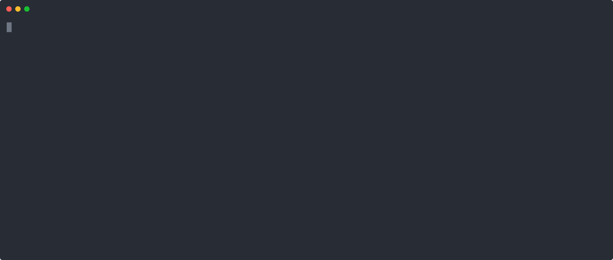

# Getting Started

Goal: go from zero to a first working chat with minimal setup.

<Info>
Fastest chat: no channel setup needed. Turn on the [web client](/admin/web/user-client)
(`gateway.webClient.enabled: true`) and chat in the browser at `http://127.0.0.1:18789/v2/client/`.
Run `wednesdayai dashboard` (or open `http://127.0.0.1:18789/` on the
<Tooltip headline="Gateway host" tip="The machine running the WednesdayAI gateway service.">gateway host</Tooltip>)
to open Control UI v2, the operator console at the gateway root.
Docs: [Dashboard](/admin/web/dashboard), [Control UI v2](/admin/web/control-ui-v2), and [Web client](/admin/web/user-client).
</Info>

## Prereqs

- Node 24 or newer

<Tip>
Check your Node version with `node --version` if you are unsure.
</Tip>

## Quick setup (CLI)

<Steps>
  <Step title="Install WednesdayAI (recommended)">
    <Tabs>
      <Tab title="macOS/Linux">
        ```bash
        curl -fsSL https://wednesdayai.dev/install.sh | bash
        ```
        
      </Tab>
      <Tab title="Windows (PowerShell)">
        ```powershell
        iwr -useb https://wednesdayai.dev/install.ps1 | iex
        ```
      </Tab>
    </Tabs>

    <Note>
    Other install methods and requirements: [Install](/admin/install).
    </Note>

  </Step>
  <Step title="Run the onboarding wizard">
    ```bash
    wednesdayai onboard --install-daemon
    ```

    The wizard configures auth, gateway settings, and optional channels.
    See [Onboarding Wizard](/users/start/wizard) for details.

  </Step>
  <Step title="Check the Gateway">
    If you installed the service, it should already be running:

    ```bash
    wednesdayai gateway status
    ```

  </Step>
  <Step title="Open the Control UI">
    ```bash
    wednesdayai dashboard
    ```
  </Step>
</Steps>

<Check>
If the Control UI loads, your Gateway is ready for use.
</Check>

## Optional checks and extras

<AccordionGroup>
  <Accordion title="Run the Gateway in the foreground">
    Useful for quick tests or troubleshooting.

    ```bash
    wednesdayai gateway --port 18789
    ```

  </Accordion>
  <Accordion title="Send a test message">
    Requires a configured channel.

    ```bash
    wednesdayai message send --target +15555550123 --message "Hello from WednesdayAI"
    ```

  </Accordion>
</AccordionGroup>

## Useful environment variables

If you run WednesdayAI as a service account or want custom config/state locations:

- `OPENCLAW_HOME` sets the home directory used for internal path resolution.
- `OPENCLAW_STATE_DIR` overrides the state directory.
- `OPENCLAW_CONFIG_PATH` overrides the config file path.

Full environment variable reference: [Environment vars](/users/help/environment).

## Go deeper

<Columns>
  <Card title="Onboarding Wizard (details)" href="/users/start/wizard">
    Full CLI wizard reference and advanced options.
  </Card>
  <Card title="macOS app onboarding" href="/users/start/onboarding">
    First run flow for the macOS app.
  </Card>
</Columns>

## What you will have

- A running Gateway
- Auth configured
- Control UI access or a connected channel

## Next steps

- DM safety and approvals: [Pairing](/admin/channels/pairing)
- Connect more channels: [Channels](/admin/channels)
- Advanced workflows and from source: [Setup](/users/start/setup)
