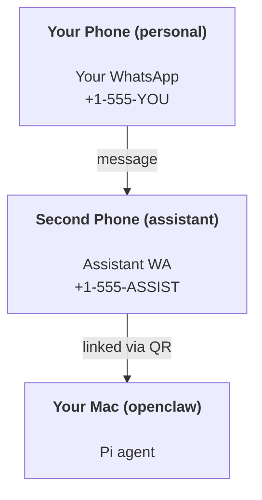

# Building a personal assistant with WednesdayAI

WednesdayAI is a WhatsApp + Telegram + Discord + iMessage gateway for **Pi** agents. Plugins add Mattermost. This guide is the "personal assistant" setup: one dedicated WhatsApp number that behaves like your always-on agent.

## ⚠️ Safety first

You’re putting an agent in a position to:

- run commands on your machine (depending on your Pi tool setup)
- read/write files in your workspace
- send messages back out via WhatsApp/Telegram/Discord/Mattermost (plugin)

Start conservative:

- Always set `channels.whatsapp.allowFrom` (never run open-to-the-world on your personal Mac).
- Use a dedicated WhatsApp number for the assistant.
- Heartbeats now default to every 30 minutes. Disable until you trust the setup by setting `agents.defaults.heartbeat.every: "0m"`.

## Prerequisites

- WednesdayAI installed and onboarded — see [Getting Started](/users/start/getting-started) if you haven't done this yet
- A second phone number (SIM/eSIM/prepaid) for the assistant

## The two-phone setup (recommended)

You want this:



If you link your personal WhatsApp to WednesdayAI, every message to you becomes “agent input”. That’s rarely what you want.

## 5-minute quick start

1. Pair WhatsApp Web (shows QR; scan with the assistant phone):

```bash
wednesdayai channels login
```

2. Start the Gateway (leave it running):

```bash
wednesdayai gateway --port 18789
```

3. Put a minimal config in `~/.openclaw/openclaw.json`:

```json5
{
  channels: { whatsapp: { allowFrom: ["+15555550123"] } },
}
```

Now message the assistant number from your allowlisted phone.

When onboarding finishes, we auto-open the dashboard with a tokenized link; the console (Control UI v2 at the gateway root) signs in with the `#token=` fragment and strips it from the address bar. If it still prompts for auth, paste the token from `gateway.auth.token` into the console sign-in screen. To reopen later: `wednesdayai dashboard`.

## Give the agent a workspace (AGENTS)

WednesdayAI reads operating instructions and “memory” from its workspace directory.

By default, WednesdayAI uses `~/.openclaw/workspace` as the agent workspace, and will create it (plus starter `AGENTS.md`, `SOUL.md`, `TOOLS.md`, `IDENTITY.md`, `USER.md`, `HEARTBEAT.md`) automatically on setup/first agent run. `BOOTSTRAP.md` is only created when the workspace is brand new (the agent finishes the ritual by deleting it with its `delete` tool, and it should not come back afterward). `MEMORY.md` is optional (not auto-created); when present, it is loaded for normal sessions. Subagent sessions only inject `AGENTS.md` and `TOOLS.md`.

Tip: treat this folder like WednesdayAI’s “memory” and make it a git repo (ideally private) so your `AGENTS.md` + memory files are backed up. If git is installed, brand-new workspaces are auto-initialized.

```bash
wednesdayai setup
```

Full workspace layout + backup guide: [Agent workspace](/developers/concepts/agent-workspace)
Memory workflow: [Memory](/developers/concepts/memory)

Optional: choose a different workspace with `agents.defaults.workspace` (supports `~`).

```json5
{
  agent: {
    workspace: "~/.openclaw/workspace",
  },
}
```

If you already ship your own workspace files from a repo, you can disable bootstrap file creation entirely:

```json5
{
  agent: {
    skipBootstrap: true,
  },
}
```

## The config that turns it into “an assistant”

WednesdayAI defaults to a good assistant setup, but you’ll usually want to tune:

- persona/instructions in `SOUL.md`
- thinking defaults (if desired)
- heartbeats (once you trust it)

Example:

```json5
{
  logging: { level: "info" },
  agent: {
    model: "anthropic/claude-opus-4-6",
    workspace: "~/.openclaw/workspace",
    thinkingDefault: "high",
    timeoutSeconds: 1800,
    // Start with 0; enable later.
    heartbeat: { every: "0m" },
  },
  channels: {
    whatsapp: {
      allowFrom: ["+15555550123"],
      groups: {
        "*": { requireMention: true },
      },
    },
  },
  routing: {
    groupChat: {
      mentionPatterns: ["@openclaw", "openclaw"],
    },
  },
  session: {
    scope: "per-sender",
    resetTriggers: ["/new", "/reset"],
    reset: {
      mode: "daily",
      atHour: 4,
      idleMinutes: 10080,
    },
  },
}
```

## Sessions and memory

- Session metadata and conversation history: SQLite at `~/.openclaw/sessions.db` by default, or the configured Postgres database. Use `wednesdayai sessions --json` to inspect session metadata.
- Old `sessions.json` / `*.jsonl` files are imported automatically on upgrade, then archived under `~/.openclaw/legacy-session-archive/`. See [Upgrading from JSON session files](/developers/concepts/session#upgrading-from-json-session-files).
- `/new` or `/reset` starts a fresh session for that chat (configurable via `resetTriggers`). If sent alone, the agent replies with a short hello to confirm the reset.
- `/compact [instructions]` compacts the session context and reports the remaining context budget.

## Heartbeats (proactive mode)

By default, WednesdayAI runs a heartbeat every 30 minutes with the prompt:
`Read HEARTBEAT.md if it exists (workspace context). Follow it strictly. Do not infer or repeat old tasks from prior chats. If nothing needs attention, reply HEARTBEAT_OK.`
Set `agents.defaults.heartbeat.every: "0m"` to disable.

- If `HEARTBEAT.md` exists but is effectively empty (only blank lines and markdown headers like `# Heading`), WednesdayAI skips the heartbeat run to save API calls.
- If the file is missing, the heartbeat still runs and the model decides what to do.
- If the agent replies with `HEARTBEAT_OK` (optionally with short padding; see `agents.defaults.heartbeat.ackMaxChars`), WednesdayAI suppresses outbound delivery for that heartbeat.
- By default, heartbeat delivery to DM-style `user:<id>` targets is allowed. Set `agents.defaults.heartbeat.directPolicy: "block"` to suppress direct-target delivery while keeping heartbeat runs active.
- Heartbeats run full agent turns — shorter intervals burn more tokens.

```json5
{
  agent: {
    heartbeat: { every: "30m" },
  },
}
```

## Media in and out

Inbound attachments (images/audio/docs) can be surfaced to your command via templates:

- `{{MediaPath}}` (local temp file path)
- `{{MediaUrl}}` (pseudo-URL)
- `{{Transcript}}` (if audio transcription is enabled)

Outbound attachments from the agent: include `MEDIA:<path-or-url>` on its own line (no spaces). Example:

```
Here’s the screenshot.
MEDIA:https://example.com/screenshot.png
```

WednesdayAI extracts these and sends them as media alongside the text.

## Operations checklist

```bash
wednesdayai status          # local status (creds, sessions, queued events)
wednesdayai status --all    # full diagnosis (read-only, pasteable)
wednesdayai status --deep   # adds gateway health probes (Telegram + Discord)
wednesdayai health --json   # gateway health snapshot (WS)
```

Logs live under `/tmp/openclaw/` (default: `openclaw-YYYY-MM-DD.log`).

## Next steps

- WebChat: [WebChat](/admin/web/webchat)
- Gateway ops: [Gateway runbook](/admin/gateway)
- Cron + wakeups: [Cron jobs](/users/automation/cron-jobs)
- macOS menu bar companion: [OpenClaw macOS app](/admin/platforms/macos)
- iOS node app: [iOS app](/admin/platforms/ios)
- Android node app: [Android app](/admin/platforms/android)
- Windows status: [Windows (WSL2)](/admin/platforms/windows)
- Linux status: [Linux app](/admin/platforms/linux)
- Security: [Security](/admin/gateway/security)
